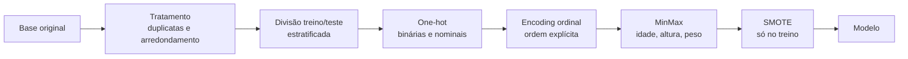

# 🩺 Classificação de Nível de Obesidade — ML, Streamlit e Power BI

Sistema preditivo para apoiar a equipe médica de um hospital na avaliação do nível de obesidade de pacientes, com pipeline de Machine Learning, aplicação em Streamlit e painel analítico em Power BI.

Projeto desenvolvido individualmente como Tech Challenge da Fase 4 da Pós-Graduação em Data Analytics (FIAP).

🔗 **App:** [Obesity Level](https://obesity-level-mpzjwzxz2futsi4liy9rnk.streamlit.app/)
📊 **Painel:** veja as imagens em [`dashboard/`](dashboard/)

---

## 🎯 O Problema

A obesidade é multifatorial, combinando fatores genéticos, ambientais e comportamentais. O desafio foi construir, a partir de uma base com dados físicos e hábitos de 2.111 pessoas, um modelo que estime o nível de obesidade em 7 classes, de "Abaixo do Peso" a "Obesidade III", e disponibilizá-lo como ferramenta para a equipe médica.

---

## 📊 Resultados

| Modelo | Acurácia no teste |
|---|---|
| **Gradient Boosting** (escolhido) | **99,3%** |
| Random Forest | 95,0% |
| Árvore de Decisão | 93,5% |
| Regressão Logística | 70,8% |

Teste com 418 pacientes reais (20% da base), separados antes de qualquer tratamento.

### E sem peso e altura?

O nível de obesidade da base é definido pelo IMC (peso ÷ altura²). Com peso e altura entre as variáveis, o modelo praticamente reaprende essa fórmula, e por isso a acurácia é tão alta.

Para medir quanto os **hábitos** explicam sozinhos, o mesmo modelo foi treinado sem essas duas variáveis: a acurácia cai para **76,6%**. É um resultado mais útil para a prática clínica, porque indica o risco a partir de comportamentos que podem ser trabalhados com o paciente.

---

## 🧠 Pipeline de Machine Learning



- **Tratamento:** remoção de 24 duplicatas e arredondamento de respostas que deveriam ser inteiras (escalas de frequência).
- **Encoding ordinal com ordem definida:** variáveis como atividade física ("Nenhuma" → "5-7x/semana") recebem a ordem real das categorias, não a alfabética.
- **Balanceamento:** SMOTE gera exemplos sintéticos das classes menores, **apenas no treino**.
- **Sem vazamento de informação:** encoders e scaler são ajustados só no treino e apenas aplicados no teste, e o teste contém apenas dados reais. O `Pipeline` do imbalanced-learn garante que o SMOTE rode no treinamento e nunca na previsão.
- **Um único arquivo de modelo:** `modelo.joblib` guarda tratamento e modelo juntos, então o app recebe os dados do paciente como estão e não repete nenhum passo manualmente.
- **Teste descartado:** uma variável de IMC foi criada e testada, mas retirada por não melhorar o modelo, já que peso e altura já carregam essa informação.

---

## 📈 Painel Analítico (Power BI)

Painel com aberturas por nível de obesidade e por gênero, filtros de idade e nível, e relações entre peso, altura, hábitos e meio de transporte. A base do painel (`data/dash.csv`) é gerada pelo próprio notebook, com os rótulos traduzidos.

O arquivo está em [`dashboard/obesity-level-dash.pbix`](dashboard/obesity-level-dash.pbix).

---

## ⚠️ Limitações

- **Base em grande parte sintética:** segundo a documentação original da base (UCI), a maior parte dos registros foi gerada artificialmente com SMOTE a partir de uma amostra menor de respostas reais. Os padrões podem não se repetir na população atendida por um hospital.
- **Peso e altura dominam a previsão:** o modelo completo é bom para classificar, mas pouco acrescenta a um médico que já tem peso e altura em mãos. A versão só com hábitos é a mais útil para prevenção.
- **Não substitui diagnóstico:** o app é uma ferramenta de apoio e mostra o IMC calculado ao lado da previsão.
- **Retreino recomendado** com dados reais do hospital antes de qualquer uso na prática.

---

## 🛠️ Tecnologias

Python · Pandas · scikit-learn · imbalanced-learn · Streamlit · Power BI · Jupyter

---

## 📁 Estrutura

```
obesity-level/
├── README.md
├── app.py                      ← aplicação Streamlit
├── transformadores.py          ← etapas do pipeline (usadas no notebook e no app)
├── modelo.joblib               ← pipeline treinado (tratamento + modelo)
├── notebook_obesidade.ipynb    ← tratamento, base do painel, treino e avaliação
├── requirements.txt            ← dependências do app
├── requirements-dev.txt        ← dependências extras para rodar o notebook
├── .gitignore
├── data/
│   ├── Obesity.csv             ← base original
│   ├── df_clean.csv            ← base tratada (gerada pelo notebook)
│   └── dash.csv                ← base do painel (gerada pelo notebook)
├── dashboard/
│   └── obesity-level-dash.pbix
└── docs/
    └── dicionario_dados.pdf
```

---

## 🚀 Como Executar

```
git clone https://github.com/RenanCostaViana/obesity-level.git
cd obesity-level
pip install -r requirements-dev.txt

# notebook (gera as bases e o modelo)
jupyter notebook notebook_obesidade.ipynb

# app
streamlit run app.py
```

---

## 📬 Contato

LinkedIn: <https://linkedin.com/in/renancostaviana>
E-mail: <renan.cv@outlook.com.br>
